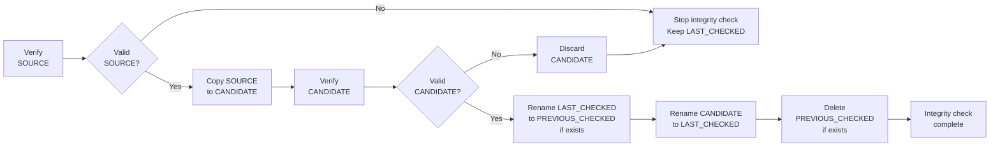

# Home Server Configuration

(section_1)=

## 1. Infrastructure and Services

(section_1_1)=

### 1.1 Reachability model

| Reachability | Meaning                                         |
| ---          | ---                                             |
| LAN          | Reachable from local network                    |
| Localhost    | Bound to `127.0.0.1` only                       |
| Public       | Exposed through router port forwarding          |
| SSHPF        | Reachable through SSH port forwarding/tunneling |
| VPN          | Reachable through WireGuard                     |
| Local        | Runs locally without exposing a network service |

(section_1_2)=

### 1.2 Service table

| Service                                    | Purpose                                    | Install mode                    | Reachability     | Ports                                                                            |
| ---                                        | ---                                        | ---                             | ---              | ---                                                                              |
| {ref}`CUDA development shell<section_10>`  | Interactive CUDA build/run environment     | Docker container                | Local            | None                                                                             |
| {ref}`Cockpit<section_6_7>`                | Web-based server administration            | Host system                     | LAN/VPN/SSHPF    | @@COCKPIT_PORT@@/TCP                                                             |
| {ref}`Home Assistant<section_7>`           | Home automation orchestration              | Virtual Machine HA OS           | LAN/VPN          | @@HOMEASSISTANT_PORT@@/TCP                                                       |
| {ref}`NFS server<section_7_3_1>`           | Staged Home Assistant backups (NFSv4 only) | Host system                     | LAN (HA VM only) | @@NFS_SERVER_PORT@@/TCP (bound to @@SERVER_IP@@ )                                |
| {ref}`Jellyfin<section_11>`                | Family media library and streaming         | Docker container                | LAN/VPN          | @@JELLYFIN_PORT@@/TCP                                                            |
| {ref}`Nextcloud<section_8>`                | Family file and photo storage              | Docker container, Nextcloud AIO | Public/LAN/VPN   | 80/TCP, 443/TCP; management: @@NC_AIO_SELFSIGNED_PORT@@/TCP, @@NC_AIO_PORT@@/TCP |
| {ref}`Pi-hole + Unbound<section_6_5>`      | DNS, DHCP and network-wide ad blocking     | Host system                     | LAN/VPN/SSHPF    | 53/TCP+UDP, 67/UDP, @@PIHOLE_HTTP_PORT@@/TCP, @@PIHOLE_HTTPS_PORT@@/TCP          |
| {ref}`SSH server<section_6_2>`             | Remote administration and development      | Host system                     | Public           | @@SSH_PORT@@/TCP                                                                 |
| Server documentation                       | Sphinx rendering of server-documentation   | Host system, systemd services   | Localhost/SSHPF  | @@SERVER_DOC_PORT@@/TCP                                                          |
| {ref}`TaskChampion sync server<section_9>` | Taskwarrior synchronization backend        | Docker container                | LAN/VPN/SSHPF    | @@TASKCHAMPION_PORT@@/TCP                                                        |
| Wikiview documentation                     | Render Markdown folders as local wikis     | Host system, systemd services   | Localhost/SSHPF  | @@WIKIVIEW_DATA_PORT@@/TCP, @@WIKIVIEW_RECIPES_PORT@@/TCP                        |
| {ref}`WireGuard VPN<section_6_4>`          | Secure remote access gateway               | Host system                     | Public           | @@WG_PORT@@/UDP                                                                  |

(section_1_3)=

### 1.3 Network convention

```text
LAN_NET=@@LAN_NET@@
VPN_NET=@@VPN_NET@@
```

(section_1_4)=

### 1.4 Infrastructure notes

- Main host runs Debian 13.
- Services may run in Docker containers where practical.
- WireGuard and SSH are the primary remote-access mechanisms.
- Pi-hole acts as the internal DNS and DHCP server.
- Unbound provides recursive DNS resolution for Pi-hole.
- NFS (NFSv4 only) is used only to give the Home Assistant VM a staged-backup target on `disk-data`. `rpc.mountd` listens on random ports as an accepted residual (see {ref}`section 7.3.1 <section_7_3_1>`).
- **Important:**
  - No reverse proxy is currently used since only Nextcloud requires public HTTP/HTTPS access. Reverse proxy support may be added later for HTTPS consolidation and additional public services.
  - Local NTP is not currently needed because the critical services run on the same server host and already share the same system clock. External devices can keep using their default internet time synchronization.

(section_1_5)=

### 1.5 Security notes

(section_1_5_1)=

#### 1.5.1 Network exposure

- Public exposure is limited to SSH, Nextcloud, and WireGuard.
- Home Assistant, Jellyfin, Cockpit, Pi-hole, and TaskChampion are accessible only through LAN, WireGuard, or SSH port forwarding.
- **Host firewall (UFW) is intentionally not used**
  - Pi-hole is the DHCP server, so that all devices automatically use Pi-hole DNS and ad blocking.
  - Enabling UFW made DHCP and local-device traffic difficult to handle cleanly, so it was removed instead of maintaining complex rules.
  - Filtering is done at the network perimeter instead.
  - If you copy this setup, evaluate whether this trade-off fits your threat model.

- TLDR: Router firewall rules, limited port forwarding, and service-specific bind addresses restrict each service to the required interfaces.

(section_1_5_2)=

#### 1.5.2 Remote and administrative access

- WireGuard provides encrypted remote access to internal services.
- SSH uses public key authentication only, and direct root login is disabled.
- Administrative privileges are obtained through `sudo` or local root escalation with `su`.
- Fail2ban mitigates repeated SSH authentication attempts.

(section_1_5_3)=

#### 1.5.3 Application authentication

- Nextcloud accounts use OTP/2FA authentication.
- Home Assistant uses application authentication and is restricted to LAN and WireGuard clients.

(section_1_5_4)=

#### 1.5.4 Secrets and backup protection

- Secrets and backup passphrases are stored using `pass`.
- The `pass` repository is backed up independently from host-managed data, as described in {ref}`section 4.3.1 <section_4_3_1>`.
- Backup repositories and service backup directories use restrictive ownership and permissions.
- Offline backup disks are normally disconnected when not in use.

(section_2)=

## 2. Hardware Components

| Component          | Details                                                                         |
| ---                | ---                                                                             |
| System             | Clevo W230SS notebook                                                           |
| CPU                | Intel i7-4712MQ (4C/8T)                                                         |
| RAM                | 16 GB                                                                           |
| GPU                | NVIDIA GTX 860M + Intel integrated graphics                                     |
| System SSD         | `disk-os`             , 250 GB , SSD , Samsung , @@DISK_SERIAL_OS@@             |
| Internal Storage   | `disk-data`           , 1 TB   , HDD , Seagate , @@DISK_SERIAL_DATA@@           |
| External Storage 1 | `disk-offline-backup` , 1 TB   , HDD , Toshiba , @@DISK_SERIAL_OFFLINE_BACKUP@@ |
| External Storage 2 | `disk-archive`        , 2 TB   , HDD , Seagate , @@DISK_SERIAL_ARCHIVE@@        |
| External Storage 3 | `disk-archive-copy`   , 2 TB   , SSD , Samsung , @@DISK_SERIAL_ARCHIVE_COPY@@   |

(section_3)=

## 3. Disk Usage

- `disk-os`: operating system and fast live services.
- `disk-data`: bulk data and online-backup copies.
- `disk-offline-backup`: offline-backup created from the online-backup.
- `disk-archive` and `disk-archive-copy`: browsable long-term archive data.

Append the following entries to the end of `/etc/fstab`. Do not replace the existing entries (root, `/home`, `/var`, `/srv`, swap, EFI). Run this once.

```bash
sudo tee -a /etc/fstab > /dev/null <<'EOF'

# Bulk internal disk: imports, staging, online-backup
UUID=@@DISK_UUID_DATA@@  /mnt/disk-data  ext4  defaults,nofail,x-systemd.device-timeout=10s  0  2

# Backup disk: offline-backup disk for current server data
UUID=@@DISK_UUID_OFFLINE_BACKUP@@  /mnt/disk-offline-backup  ext4  defaults,nofail,x-systemd.device-timeout=10s  0  2

# Archive disk: old inactive long-term data
UUID=@@DISK_UUID_ARCHIVE@@  /mnt/disk-archive  ext4  defaults,nofail,x-systemd.device-timeout=10s  0  2

# Archive copy disk: non-deleting second copy of disk-archive
UUID=@@DISK_UUID_ARCHIVE_COPY@@  /mnt/disk-archive-copy  ext4  defaults,nofail,x-systemd.device-timeout=10s  0  2
EOF
```

Verify the file and mount the new entries:

```bash
sudo findmnt --verify
sudo systemctl daemon-reload
sudo mount -a
findmnt /mnt/disk-data
```

(section_3_1)=

### 3.1 `disk-os`

- Used for the operating system and fast live services

 | Device | Mount Point | Size | Type     | Filesystem | Purpose                                                        |
 | ---    | ---         | ---  | ---      | ---        | ---                                                            |
 | sda1   | `/boot/efi` | 1G   | primary  | FAT32      | EFI boot partition                                             |
 | sda2   | -           | 249G | extended | -          | Container for logical partitions                               |
 | sda6   | `/`         | 50G  | logical  | ext4       | Base operating system and packages                             |
 | sda7   | `/home`     | 30G  | logical  | ext4       | Dotfiles, configuration, and lightweight user data             |
 | sda8   | `/var`      | 80G  | logical  | ext4       | Runtime service data, logs, databases, and container internals |
 | sda9   | `/srv`      | 81G  | logical  | ext4       | Persistent repositories, applications, and user data           |
 | sda5   | swap        | 8G   | logical  | swap       | Memory overflow and emergency swap space                       |

- Partitioning is based on observed usage after more than 18 months of deployment (2025–2026).
- Device `sda2` is an extended partition container required by the old MBR/msdos partition table. The usable logical partitions are `sda5` to `sda9` inside it.
- The separation of `/`, `/var`, and `/srv` is intentional to simplify reinstalls, migrations, backups, recovery, and containerized deployments.

(section_3_1_1)=

#### 3.1.1 Folder structure

```text
/home/@@OWNER@@
├── repos
│   ├── external
│   └── personal
└── temp
```

```text
/srv/
├── @@OWNER@@-data           # @@OWNER@@:@@OWNER@@, 755; personal data
├── @@OWNER@@-repos          # @@OWNER@@:@@OWNER@@, 755; personal Git repositories
├── cuda-dev                 # @@OWNER@@:@@OWNER@@, 755; CUDA development
├── jellyfin                 # @@OWNER@@:@@OWNER@@, 755; Jellyfin configuration, database, and cache
├── libvirt                  # @@OWNER@@:@@OWNER@@, 755; VM images: Home Assistant VM
├── lost+found
├── nextcloud                # root:root, 755; Nextcloud host directory; AIO manages data internally
├── taskchampion-sync-server # @@OWNER@@:@@OWNER@@, 755; TaskChampion server data
│   └── data                 # @@OWNER@@:@@OWNER@@, 700
└── temp                     # @@OWNER@@:@@OWNER@@, 755; temporary files on fast storage
```

(section_3_1_2)=

#### 3.1.2 Folder setup

```bash
# Create persistent application and user-data directories on disk-os
sudo mkdir -p \
  /srv/@@OWNER@@-data \
  /srv/@@OWNER@@-repos \
  /srv/cuda-dev/projects \
  /srv/jellyfin/config \
  /srv/jellyfin/cache \
  /srv/libvirt/images/homeassistant \
  /srv/nextcloud/data \
  /srv/taskchampion-sync-server/data \
  /srv/temp

# Assign user-managed directories to @@OWNER@@
sudo chown -R @@OWNER@@:@@OWNER@@ \
  /srv/@@OWNER@@-data \
  /srv/@@OWNER@@-repos \
  /srv/cuda-dev \
  /srv/jellyfin \
  /srv/libvirt/images/homeassistant \
  /srv/taskchampion-sync-server \
  /srv/temp

# Set directory permissions for general user-managed data
sudo find \
  /srv/@@OWNER@@-data \
  /srv/@@OWNER@@-repos \
  /srv/cuda-dev \
  /srv/jellyfin \
  /srv/libvirt/images/homeassistant \
  /srv/temp \
  -type d -exec chmod 755 {} +

# Set TaskChampion permissions separately
sudo chmod 755 /srv/taskchampion-sync-server
sudo chmod 700 /srv/taskchampion-sync-server/data

# Assign the Nextcloud host directories to root; AIO manages content permissions internally
sudo chown root:root \
  /srv/nextcloud \
  /srv/nextcloud/data

sudo chmod 755 \
  /srv/nextcloud \
  /srv/nextcloud/data
```

- If `/srv` becomes too full, move cold Nextcloud data first to `disk-data/nextcloud-external`.

(section_3_1_3)=

#### 3.1.3 Nextcloud and Jellyfin shared media permissions

The Nextcloud Group Folder is managed by Nextcloud AIO.

- **Nextcloud:** full read/write access to the Group Folder.
- **Jellyfin:** read-only access to the shared media (cannot create, modify, delete, or move files in the Group Folder).
- **New media:** automatically remains readable by Jellyfin while staying writable by Nextcloud.

- The shared media directories are:

```text
/srv/nextcloud/data/__groupfolders/1/files/
├── Photos
└── Videos
    ├── Downloaded
    └── Recorded
```

- Apply the Jellyfin ACLs:

```bash
sudo setfacl -R -m u:1000:rX \
  /srv/nextcloud/data/__groupfolders/1/files

sudo find /srv/nextcloud/data/__groupfolders/1/files \
  -type d \
  -exec setfacl -m u:1000:r-x,d:u:1000:r-x,d:m:r-x {} +

sudo find /srv/nextcloud/data/__groupfolders/1/files \
  -type f \
  -exec setfacl -m u:1000:r-- {} +
```

- Verify a representative file and its parent directory

```bash
TMPFILE=$(sudo find /srv/nextcloud/data/__groupfolders/1/files/Photos -type f ! -path '*/.Trash-*/*' -print -quit)

sudo getfacl -p "$TMPFILE"

sudo -u '#1000' test -r "$TMPFILE" && echo "READ: OK" || echo "READ: DENIED"
sudo -u '#1000' test -w "$TMPFILE" && echo "WRITE: BAD — writable!" || echo "WRITE: OK — denied"

DIR="$(dirname "$TMPFILE")"

sudo -u '#1000' test -x "$DIR" && echo "DIRECTORY TRAVERSE: OK" || echo "DIRECTORY TRAVERSE: DENIED"
sudo -u '#1000' test -w "$DIR" && echo "DIRECTORY WRITE: BAD — writable!" || echo "DIRECTORY WRITE: OK — denied"

## Expected result:

# READ: OK
# WRITE: OK — denied
# DIRECTORY TRAVERSE: OK
# DIRECTORY WRITE: OK — denied
```

- Jellyfin's Docker Compose configuration keeps the shared media mounts read-only ({ref}`section 11.3 <section_11_3>`).

(section_3_1_4)=

#### 3.1.4 Nextcloud Group Folder file-cache issue

Files in the Nextcloud Group Folder `/@@NC_USER@@/files/Family/Photos/...` could occasionally not be moved.
Nextcloud reported that the source file `cannot be deleted`, even though the Group Folder granted `read`, `write`, `create`, and `delete` permissions.
The underlying filesystem permissions were also correct: `www-data` could read the file, write and traverse its parent directory, and successfully create and delete a test file.
However, Nextcloud's `File` node reported `deletable: NO` with permission bits `19`, while the parent directory correctly reported full permissions (`31`).
This showed that the problem was not caused by Unix ownership, filesystem permissions, ACLs, or Group Folder permissions.

The problem appeared to be caused by stale or inconsistent Nextcloud file-cache metadata.
It was resolved by rescanning the affected directory with Nextcloud's `occ files:scan`, which restored the missing delete permission.
After the rescan, the file could be moved normally.
No changes to filesystem ownership, permissions, or ACLs were required.
If the same symptom occurs again, first verify the effective Nextcloud permissions and filesystem access, then rescan the affected directory rather than changing the underlying ACL configuration.

```bash
# Rescan an affected Group Folder directory
sudo docker exec --user www-data nextcloud-aio-nextcloud \
  php occ files:scan \
  --path="/@@NC_USER@@/files/Family/Photos/@@FAMILY_DIR_1@@/@@FAMILY_NAME_1@@/Photos" \
  -v
```

(section_3_2)=

### 3.2 `disk-data`

- The disk is installed in the server and is used for bulk data, online-backups, and temporary files.
- General-purpose directories are owned by `@@OWNER@@:@@OWNER@@` and use mode `0755`.
- Backup directories use restrictive or service-specific ownership and permissions.
- Backup scripts run as `root` so they can read application data and preserve ownership and permissions.

(section_3_2_1)=

#### 3.2.1 Folder structure

```text
/mnt/disk-data/
├── jellyfin-media               # @@OWNER@@:@@OWNER@@, 755; media backed up directly to offline Borg
│   ├── movies                   # @@OWNER@@:@@OWNER@@, 755
│   └── shows                    # @@OWNER@@:@@OWNER@@, 755
├── nextcloud-external           # @@OWNER@@:@@OWNER@@, 755; Nextcloud external storage, backed up directly to offline Borg
├── online-backups               # root:root, 711; traversal without directory listing
│   ├── staged                   # root:root, 711; staged backups
│   │   ├── host-managed         # root:root, 700; host-managed Borg repositories
│   │   ├── homeassistant        # nobody:nogroup, 770; NFS target for Home Assistant backups
│   │   ├── homeassistant_7_4_12 # root:root, 700; Home Assistant 7-4-12 backup set
│   │   └── nextcloud            # root:root, 700; Nextcloud AIO Borg repository
│   └── integrity-checked        # root:root, 700; validated backup copies
│       ├── host-managed         # root:root, 700
│       ├── homeassistant_7_4_12 # root:root, 700
│       └── nextcloud            # root:root, 700
└── temp                         # @@OWNER@@:@@OWNER@@, 755; general-purpose temporary files
```

- `nextcloud-external` is mounted read/write into the Nextcloud container and is owned by `@@OWNER@@:@@OWNER@@`.
- The `0711` permissions on `online-backups` and `online-backups/staged` allow the Home Assistant NFS identity to traverse the path without listing its contents.
- See {ref}`section 4.3 <section_4_3>` for host-managed repositories and {ref}`section 4.5 <section_4_5>` for offline-backups.

(section_3_2_2)=

#### 3.2.2 Folder setup

```bash
# General-purpose media and temporary directories.
sudo install -d -o @@OWNER@@ -g @@OWNER@@ -m 0755 \
    /mnt/disk-data/jellyfin-media \
    /mnt/disk-data/jellyfin-media/movies \
    /mnt/disk-data/jellyfin-media/shows \
    /mnt/disk-data/temp

# Nextcloud external-storage directory.
# Ownership and permissions must correspond to the container mount and
# Nextcloud External Storage configuration.
sudo install -d -o @@OWNER@@ -g @@OWNER@@ -m 0755 \
    /mnt/disk-data/nextcloud-external

# Backup parent directories.
#
# Mode 0711 permits traversal to the Home Assistant NFS directory without
# allowing normal users to list the parent directories.
sudo install -d -o root -g root -m 0711 \
    /mnt/disk-data/online-backups \
    /mnt/disk-data/online-backups/staged

# Root-managed staged and integrity-checked backup directories.
sudo install -d -o root -g root -m 0700 \
    /mnt/disk-data/online-backups/staged/host-managed \
    /mnt/disk-data/online-backups/staged/homeassistant_7_4_12 \
    /mnt/disk-data/online-backups/staged/nextcloud \
    /mnt/disk-data/online-backups/integrity-checked \
    /mnt/disk-data/online-backups/integrity-checked/host-managed \
    /mnt/disk-data/online-backups/integrity-checked/homeassistant_7_4_12 \
    /mnt/disk-data/online-backups/integrity-checked/nextcloud

# Home Assistant NFS backup directory.
sudo install -d -o nobody -g nogroup -m 0770 \
    /mnt/disk-data/online-backups/staged/homeassistant
```

- Backup-tree copies performed with `rsync` use `--archive --numeric-ids` to preserve ownership, permissions, timestamps, symbolic links, and numeric user and group IDs.
- ACLs, extended attributes, and hard links are not preserved unless the corresponding `rsync` options are added.

(section_3_3)=

### 3.3 `disk-offline-backup`

- Stores backups offline
- This disk is normally disconnected from the server when not in use.
- The backup root directory is owned by `root:root` and accessible only by `root`.
- Ownership and permissions inside the backup data are preserved because they may be required during restoration.

(section_3_3_1)=

#### 3.3.1 Folder structure and setup

```text
/mnt/disk-offline-backup/@@SERVER_NAME@@/
├── integrity-checked     # mirror of /mnt/disk-data/online-backups/integrity-checked
└── offline-managed       # Borg repositories of large, infrequently changing datasets.
    ├── jellyfin-media
    └── nextcloud-external
```

```bash
# Create the server-specific offline-backup root.
sudo install -d -o root -g root -m 0700 \
    /mnt/disk-offline-backup/@@SERVER_NAME@@ \
    /mnt/disk-offline-backup/@@SERVER_NAME@@/offline-managed
```

(section_3_4)=

### 3.4 `disk-archive`

- Stores old inactive data (old laptops, etc.).

```text
/mnt/disk-archive/<data-owner>/<YYYY-MM-DD_short-description>  # old inactive data kept for long-term reference
```

(section_3_5)=

### 3.5 `disk-archive-copy`

- Stores a non-deleting browsable `rsync` copy of `disk-archive`.

(section_4)=

## 4. Backup and Recovery

(section_4_1)=

### 4.1 Backup Overview

(section_4_1_1)=

#### 4.1.1 Strategies

- Two backup strategies are used:
  - multi-stage backup;
  - direct-to-offline backup.

- To avoid repeating long paths in this section, the following variables are used:
  - `ONLINE_BACKUPS=/mnt/disk-data/online-backups`;
  - `OFFLINE_BACKUPS=/mnt/disk-offline-backup/@@SERVER_NAME@@`.

##### 4.1.1.1 Multi-stage backup

- A multi-stage backup uses three stages:

1. Staged backup
   - Created daily by the application or a host-managed backup script.
   - Stored under `$ONLINE_BACKUPS/staged`.

2. Integrity-checked backup
   - A copy of the staged backup that has passed the applicable integrity checks.
   - Stored under `$ONLINE_BACKUPS/integrity-checked`.
   - Does not protect against failure of `disk-data`, because both copies remain on the same physical disk.

3. Offline backup
   - A manual mirror of the integrity-checked backup.
   - Stored under `$OFFLINE_BACKUPS/integrity-checked`.
   - Files removed from the integrity-checked backup are also removed from the offline mirror during synchronization.

(section_4_1_1_2)=

##### 4.1.1.2 Direct-to-offline backup

- A direct-to-offline backup writes data directly to Borg repositories stored under `$OFFLINE_BACKUPS/offline-managed`.
- Each backup is created directly on the offline disk.
- Repository integrity checks are performed according to the direct-to-offline backup procedure.
- These backups should preferably be performed during the same maintenance session as the offline mirroring of the multi-stage backups.

(section_4_1_2)=

#### 4.1.2 Verification

- Backup verification consists of three distinct activities:

1. Integrity check
   - Confirms that the backup can be opened and read without detected structural corruption.
   - Examples include `borg check` for Borg repositories and reading every member of a TAR archive.
   - Performed automatically by the corresponding backup integrity-check scripts.

2. Restore test
   - Restores selected data or a complete backup to an isolated temporary location.
   - Confirms that the restored data can be accessed.
   - Performed manually.

3. Content verification
   - Confirms that the restored data is complete, current, and usable.
   - Performed manually.

- **Important:**
  - Automated scripts perform integrity checks only.
  - An integrity check does not prove that the source data was complete or that a full application recovery will succeed.
  - Restore tests and content verification are manual maintenance activities.
  - They should be performed particularly after major changes to the backup or recovery setup.

(section_4_1_3)=

#### 4.1.3 Retention

- Retention is enforced by the application, Borg, or the backup integrity-check script, depending on the dataset.
- Home Assistant Dataset integrity-checked backups follow the `7-4-12` policy.
- All other Borg repositories follow the `7-4-12-10` policy.

- The `7-4-12` policy keeps:
  - one backup per day for the last 7 days;
  - one backup per week for the last 4 weeks;
  - one backup per month for the last 12 months.

- The `7-4-12-10` policy follows the `7-4-12` policy and keeps one backup per year for the last 10 years.

- **Notes:**
  - For Borg repositories, retention applies to archives inside the repository.
  - It does not create separate daily, weekly, monthly, or yearly copies of the repository.

(section_4_1_4)=

#### 4.1.4 Backup integrity-check workflow

- All backup integrity-check scripts implement the following workflow:



- `SOURCE` is the staged backup in `$ONLINE_BACKUPS/staged` to be checked and copied into `$ONLINE_BACKUPS/integrity-checked`.
- `CANDIDATE` is the temporary copy of `SOURCE`.
- `LAST_CHECKED` is the most recent copy that successfully passed its integrity check.
- `PREVIOUS_CHECKED` is the former `LAST_CHECKED`, retained temporarily until the new candidate becomes `LAST_CHECKED`.
- The source and candidate are checked separately:
  - checking `SOURCE` avoids copying a known-corrupt backup;
  - checking `CANDIDATE` confirms that the copied data can be read without detected corruption.
- `CANDIDATE`, `LAST_CHECKED`, and `PREVIOUS_CHECKED` must reside on the same filesystem so that their renames are atomic.

(section_4_1_5)=

#### 4.1.5 Summary

- Datasets are classified into three categories:
  - HAD — Home Assistant Dataset;
  - NCD — Nextcloud Dataset;
  - HMD — Host-Managed Dataset.

   | Dataset                    | Category                | Backup strategy   | Primary data                                             | Staged backup                    | Backup schedule   | Integrity-checked backup    | Integrity-check schedule    | Offline backup                  |
   | -------------------------- | ----------------------- | ----------------- | -------------------------------------------------------- | -------------------------------- | ---------------   | --------------------------- | --------------------------- | ------------------------------- |
   | Home Assistant             | {ref}`HAD<section_4_2>` | Multi-stage       | Home Assistant OS data                                   | `7-4-12` backup set              | Odd days at 05:30 | Checked `7-4-12` backup set | First day of month at 06:00 | Mirror of integrity-checked     |
   | Nextcloud AIO data         | {ref}`NCD<section_4_4>` | Multi-stage       | AIO-managed application data                             | AIO Borg repository              | Daily at 03:00    | Checked repository copy     | First day of month at 04:00 | Mirror of integrity-checked     |
   | CUDA development           | {ref}`HMD<section_4_3>` | Multi-stage       | `/srv/cuda-dev`                                          | Encrypted Borg repository        | Daily at 01:00    | Checked repository copy     | First day of month at 02:00 | Mirror of integrity-checked     |
   | TaskChampion               | {ref}`HMD<section_4_3>` | Multi-stage       | `/srv/taskchampion-sync-server`                          | Encrypted Borg repository        | Daily at 01:00    | Checked repository copy     | First day of month at 02:00 | Mirror of integrity-checked     |
   | `@@OWNER@@-data`           | {ref}`HMD<section_4_3>` | Multi-stage       | `/srv/@@OWNER@@-data`                                    | Encrypted Borg repository        | Daily at 01:00    | Checked repository copy     | First day of month at 02:00 | Mirror of integrity-checked     |
   | `@@OWNER@@-repos`          | {ref}`HMD<section_4_3>` | Multi-stage       | `/srv/@@OWNER@@-repos`                                   | Encrypted Borg repository        | Daily at 01:00    | Checked repository copy     | First day of month at 02:00 | Mirror of integrity-checked     |
   | Jellyfin configuration     | {ref}`HMD<section_4_3>` | Multi-stage       | `/srv/jellyfin/config`, `/srv/jellyfin/compose.yaml`     | Encrypted Borg repository        | Daily at 01:00    | Checked repository copy     | First day of month at 02:00 | Mirror of integrity-checked     |
   | Jellyfin media             | {ref}`HMD<section_4_3>` | Direct-to-offline | `/mnt/disk-data/jellyfin-media`                          | —                                | —                 | —                           | —                           | Offline-managed Borg repository |
   | Nextcloud external         | {ref}`HMD<section_4_3>` | Direct-to-offline | `/mnt/disk-data/nextcloud-external`                      | —                                | —                 | —                           | —                           | Offline-managed Borg repository |

(section_4_1_6)=

#### 4.1.6 Encryption

- The HAD backup is not encrypted.
- The NCD backup is an encrypted Borg repository.
- HMD backups are encrypted Borg repositories.

Borg repositories created with repository-key encryption require only the repository passphrase for recovery because the encrypted key is stored in the repository.

##### 4.1.6.1 Storage of secrets for encrypted backups

- Encryption secrets are stored in a dedicated `pass` repository. The GPG keys required to decrypt that password store are stored on `disk-archive`.
- Because most encrypted backups are Borg repositories, the bare Git repository for the password store is named `@@BORG_PASSWORD_STORE_REPO@@`.

```text
@@SECRETS_DIR@@/
├── @@BORG_PASSWORD_STORE_REPO@@ # Bare git repository
├── @@GPG_PUBLIC_KEY_FILE@@
└── @@GPG_SECRET_KEY_FILE@@
```

- This password store is separate from the daily password store in `$HOME/.password-store`.
- To read the stored passwords, import the GPG keys and clone the repository:

```bash
# Import the GPG keys.
gpg --import @@SECRETS_DIR@@/@@GPG_PUBLIC_KEY_FILE@@
gpg --import @@SECRETS_DIR@@/@@GPG_SECRET_KEY_FILE@@

# Clone the Borg password store.
git clone \
    @@SECRETS_DIR@@/@@BORG_PASSWORD_STORE_REPO@@ \
    /root/borg-password-store

# Configure the Git identity for this repository if necessary.
# git -C /root/borg-password-store config user.name  "<name>"
# git -C /root/borg-password-store config user.email "<email>"

# Read the Borg credentials.
PASSWORD_STORE_DIR=/root/borg-password-store pass show borg-repos
```

(section_4_1_6_2)=

##### 4.1.6.2 Generate encryption secrets for new HMD repositories

- Each encrypted repository has a separate passphrase stored in the single `pass` entry `borg-repos`.
- Generate each passphrase with `pwgen -ys 32 -i`.
- Each repository record contains exactly three lines:

```text
passphrase
repository-name
description
```

- Populate each record accordingly.

- **Important:**
  - The `nextcloud` record is created by the application.

(section_4_1_6_3)=

##### 4.1.6.3 Generate the root-only environment for Borg repositories

- The backup scripts use `/etc/borg/passphrases.env` as a convenience file for accessing credentials.
- The authoritative credentials remain in the Borg password store on `disk-archive`.
- The environment file must be regenerated whenever a passphrase or repository name changes.

````{dropdown} Show script
```{literalinclude} configuration/backup-strategy/generate-root-env-with-borg-credentials.sh
:language: bash
:linenos:
```
````

(section_4_2)=

### 4.2 Home Assistant Dataset (HAD)

(section_4_2_1)=

#### 4.2.1 Staged backups

- Home Assistant creates native `.tar` backups and retains at most one backup per day for the latest five days in the staged backup directory, as defined in {ref}`section 7.3 <section_7_3>`.
- The host-side script {ref}`homeassistant-backup-policy-enforcer.py<ha_backup_policy_enforcer>` copies new staged backups into the persistent `7-4-12` backup set under `$ONLINE_BACKUPS/staged/homeassistant_7_4_12`.
- The policy enforcer runs regularly so that staged backups are copied before Home Assistant removes backups older than five days.
- The `7-4-12` backup set is retained independently of the staged directory.
- Retention is based on file modification timestamps.
- A process lock prevents concurrent executions of the policy-enforcer script.

````{dropdown} Show script

(ha_backup_policy_enforcer)=

```{literalinclude} configuration/backup-strategy/home-assistant-dataset/homeassistant-backup-policy-enforcer.py
:language: python
:linenos:
```
````

(section_4_2_1_1)=

#### 4.2.1.1 Automation of staged backups

- Service

````{dropdown} Show script
```{literalinclude} configuration/backup-strategy/home-assistant-dataset/homeassistant-backup-policy-enforcer.service
:language: ini
:linenos:
```
````

- Timer. Executes on odd days at 05:30.

````{dropdown} Show script
```{literalinclude} configuration/backup-strategy/home-assistant-dataset/homeassistant-backup-policy-enforcer.timer
:language: ini
:linenos:
```
````

- Install service

````{dropdown} Show script
```{literalinclude} configuration/backup-strategy/home-assistant-dataset/install-automatic-homeassistant-backup-policy-enforcer.sh
:language: bash
:linenos:
```
````

#### 4.2.2 Integrity-checked backups

- The host-side script {ref}`homeassistant-backup-integrity-check.py<ha_backup_integrity_check>` applies the workflow defined in {ref}`section 4.1.4 <section_4_1_4>` to the complete `7-4-12` backup set.

````{dropdown} Show script

(ha_backup_integrity_check)=

```{literalinclude} configuration/backup-strategy/home-assistant-dataset/homeassistant-backup-integrity-check.py
:language: python
:linenos:
```
````

(section_4_2_2_1)=

#### 4.2.2.1 Automation of integrity-checked backups

- Service

````{dropdown} Show script
```{literalinclude} configuration/backup-strategy/home-assistant-dataset/homeassistant-backup-integrity-check.service
:language: ini
:linenos:
```
````

- Timer. Executes on the first day of each month at 06:00.

````{dropdown} Show script
```{literalinclude} configuration/backup-strategy/home-assistant-dataset/homeassistant-backup-integrity-check.timer
:language: ini
:linenos:
```
````

- Install service

````{dropdown} Show script
```{literalinclude} configuration/backup-strategy/home-assistant-dataset/install-automatic-homeassistant-backup-integrity-check.sh
:language: bash
:linenos:
```
````

(section_4_3)=

### 4.3 Host-Managed Datasets (HMD)

- These datasets use host-side scripts to create staged backups as Borg repositories that follow the `7-4-12-10` retention policy.
- Host-managed staged repositories reside under `$ONLINE_BACKUPS/staged/host-managed/`.
- Their integrity-checked copies reside under `$ONLINE_BACKUPS/integrity-checked/host-managed/`.

(section_4_3_1)=

#### 4.3.1 Initialize Borg repositories

````{dropdown} Show script
```{literalinclude} configuration/backup-strategy/host-managed-dataset/initialize-all-borg-repositories.sh
:language: bash
:linenos:
```
````

````{dropdown} Show script
```{literalinclude} configuration/backup-strategy/host-managed-dataset/initialize-single-borg-repository.sh
:language: bash
:linenos:
```
````

(section_4_3_2)=

#### 4.3.2 Staged backups

````{dropdown} Show script
```{literalinclude} configuration/backup-strategy/host-managed-dataset/borg-backup.sh
:language: bash
:linenos:
```
````

(section_4_3_2_1)=

#### 4.3.2.1 Automation of staged backups

- Service

````{dropdown} Show script
```{literalinclude} configuration/backup-strategy/host-managed-dataset/borg-backup@.service
:language: ini
:linenos:
```
````

- Timer. Runs every day at 01:00.

````{dropdown} Show script
```{literalinclude} configuration/backup-strategy/host-managed-dataset/borg-backup@.timer
:language: ini
:linenos:
```
````

- Install service

````{dropdown} Show script
```{literalinclude} configuration/backup-strategy/host-managed-dataset/install-automatic-borg-backups.sh
:language: bash
:linenos:
```
````

(section_4_3_3)=

#### 4.3.3 Integrity-checked backups

````{dropdown} Show script
```{literalinclude} configuration/backup-strategy/host-managed-dataset/borg-integrity-check.sh
:language: bash
:linenos:
```
````

(section_4_3_3_1)=

#### 4.3.3.1 Automation of integrity-checked backups

- Service

````{dropdown} Show script
```{literalinclude} configuration/backup-strategy/host-managed-dataset/borg-integrity-check@.service
:language: ini
:linenos:
```
````

- Timer. Runs on the first day of every month at 02:00.

````{dropdown} Show script
```{literalinclude} configuration/backup-strategy/host-managed-dataset/borg-integrity-check@.timer
:language: ini
:linenos:
```
````

- Install service

````{dropdown} Show script
```{literalinclude} configuration/backup-strategy/host-managed-dataset/install-automatic-borg-integrity-check.sh
:language: bash
:linenos:
```
````

(section_4_4)=

### 4.4 Nextcloud Dataset (NCD)

#### 4.4.1 Staged backups

- Nextcloud AIO manages a Borg repository that follows the `7-4-12-10` retention policy and creates daily backups at 03:00 under `$ONLINE_BACKUPS/staged/nextcloud/borg`.

#### 4.4.2 Integrity-checked backups

- The host-side script {ref}`nextcloud-aio-backup-integrity-check.sh<nc_backup_integrity_check>` applies the workflow defined in {ref}`section 4.1.4 <section_4_1_4>` to the repository managed by the application.

````{dropdown} Show script

(nc_backup_integrity_check)=

```{literalinclude} configuration/backup-strategy/nextcloud-dataset/nextcloud-aio-backup-integrity-check.sh
:language: bash
:linenos:
```
````

(section_4_4_2_1)=

#### 4.4.2.1 Automation of integrity-checked backups

- Service

````{dropdown} Show script
```{literalinclude} configuration/backup-strategy/nextcloud-dataset/nextcloud-aio-backup-integrity-check.service
:language: ini
:linenos:
```
````

- Timer. Runs on the first day of every month at 04:00.

````{dropdown} Show script
```{literalinclude} configuration/backup-strategy/nextcloud-dataset/nextcloud-aio-backup-integrity-check.timer
:language: ini
:linenos:
```
````

- Install service

````{dropdown} Show script
```{literalinclude} configuration/backup-strategy/nextcloud-dataset/install-automatic-nextcloud-aio-backup-integrity-check.sh
:language: bash
:linenos:
```
````

(section_4_5)=

### 4.5 Offline backup copy

- The script {ref}`offline-backup-copy.sh<offline_backup_copy>` copies the complete integrity-checked backup tree from `$ONLINE_BACKUPS/integrity-checked` to `$OFFLINE_BACKUPS/integrity-checked`. It follows the workflow defined in {ref}`section 4.1.4 <section_4_1_4>`, except that it omits the initial source integrity check.
- It also updates and integrity-checks two Borg repositories directly under `$OFFLINE_BACKUPS/offline-managed` for large, infrequently changing datasets:
  - `jellyfin-media`;
  - `nextcloud-external`.

````{dropdown} Show script

(offline_backup_copy)=

```{literalinclude} configuration/backup-strategy/offline-backup-copy.sh
:language: bash
:linenos:
```
````

- After running the script:

```bash
sync
sudo umount /mnt/disk-offline-backup
```

(section_4_6)=

### 4.6 Reinstall systemd services script

````{dropdown} Show script
```{literalinclude} configuration/backup-strategy/reinstall-backup-services.sh
:language: bash
:linenos:
```
````

(section_5)=

## 5. Basic Server Configuration

(section_5_1)=

### 5.1 Mount unknown USB drives

- Known disks are mounted through `/etc/fstab`.
- Unknown or temporary USB drives are mounted manually with `udisksctl`.

```bash
# Install
sudo apt install udisks2 udiskie

# Add permissions
sudo usermod -aG plugdev @@OWNER@@
sudo reboot
```

- Usage:

```bash
# Mount
lsblk -f
udisksctl mount -b /dev/sdX1   # This will mount something like `/media/@@OWNER@@/<LABEL>`

# Unmount
sync
udisksctl unmount -b /dev/sdX1
udisksctl power-off -b /dev/sdX
```

(section_5_2)=

### 5.2 Configure lid behavior

- Configure the server to continue running when the laptop lid is closed.

```text
# /etc/systemd/logind.conf

HandleLidSwitch=ignore
HandleLidSwitchExternalPower=ignore
HandleLidSwitchDocked=ignore
```

- Reboot after changing the configuration.

- Expected behavior:
  - Closing the lid does not suspend the server.
  - Opening the lid restores the display.
